# Pascal-to-Java Enterprise Modernization Platform

A discovery-first enterprise platform that analyzes legacy Pascal estates, converts only a measured, capability-scoped subset into maintainable Java, and issues evidence-based certification of behavioral equivalence for exactly the scope that was tested.

**AI/LLM policy (hard rule):** the shipped product contains no LLM, no ML inference, no embeddings, no RAG, no vector stores and no probabilistic code generation. All detection, planning, transformation and verdict decisions are deterministic: parsers, compiler metadata, static analysis, exact rules, typed intermediate representations and reproducible execution. OpenCode/ECC are development-time authoring tools only and do not change this requirement.

## Table of contents

- Status: [maturity](#project-maturity-and-status) · [overview](#overview) · [problem](#problem-being-solved) · [goals and principles](#goals-and-engineering-principles)
- Analysis: [capabilities and status](#key-capabilities-and-feature-status) · [dialect and application coverage](#pascal-dialect-and-application-coverage-matrix) · [architecture](#architecture-at-a-glance) · [workflow](#end-to-end-modernization-workflow)
- Semantics: [Semantic IR](#deterministic-semantic-ir-and-transformation-approach) · [dependency discovery](#enterprise-dependency-discovery) · [database strategy](#database-preservation-strategy) · [Java output profiles](#java-output-profiles) · [runtime equivalence](#runtime-and-behavioral-equivalence)
- Engineering: [technology stack](#technology-stack) · [open-source vs custom](#open-source-components-vs-custom-platform-components) · [repository structure](#repository-structure) · [prerequisites](#prerequisites) · [installation](#installation-and-quick-start) · [configuration](#configuration) · [commands](#development-commands) · [testing](#testing-and-verification) · [security](#security)
- Delivery: [limitations](#current-limitations) · [roadmap](#roadmap) · [references](#references)

## Project maturity and status

**This repository is at the initialization stage. No implementation has been committed yet** — the working tree contains only `.git` (zero commits): no source code, no build manifest, no tests, no CI workflows, no `docs/` tree, no environment templates. Every platform capability described below is **PLANNED**. The architecture itself is approved in external reference documents (Final architecture v3.0, research snapshot 12 November 2026) held outside this repository — see [References](#references). Next step: roadmap phase P0 (feasibility and tool bake-off).

| Area | Status | Evidence |
|---|---|---|
| Repository contents | Initialization only | Repository has zero commits; no implementation present |
| Ingestion & discovery | PLANNED | Repository has zero commits; no implementation present |
| Parser frontends & Semantic IR | PLANNED | Repository has zero commits; no implementation present |
| Transformation & Java generation | PLANNED | Repository has zero commits; no implementation present |
| Oracle execution & certification | PLANNED | Repository has zero commits; no implementation present |
| Security & sandboxing | PLANNED | Repository has zero commits; no implementation present |
| Architecture contract | Approved (external) | Defined in external reference documents; not yet reflected in code |

## Overview

The unit of modernization is the application **estate**, not an isolated `.pas` file. The platform must determine what a customer actually owns — dialect, compiler/version, directives, target OS/CPU, build model, project type, runtime libraries, native dependencies, data access, schedules, protocols, database contracts and operational behavior — before any conversion is attempted. Universal discovery is the goal; universal automatic conversion is explicitly not a first-release promise. The product identifies widely, converts only a measured subset, makes unsupported elements explicit, and certifies only the exact scope for which original-versus-Java evidence exists. Target outputs are Plain Java (JVM 25 baseline) and Spring Boot from one target-neutral Java IR; the customer's existing database is preserved by default.

## Problem being solved

Enterprise Pascal estates (Delphi/Object Pascal, Free Pascal/Lazarus, Turbo/Borland Pascal, ISO variants and vendor dialects) carry decades of business logic that is expensive to maintain, hard to hire for and coupled to legacy toolchains, GUI frameworks, native libraries and databases. Existing converter tools either handle a single dialect fragment, stop at syntax, or cannot prove that generated Java behaves like the original. Buyers need a defensible answer to "what can safely be converted, and how do we know it is equivalent?" — with audit evidence, not optimism.

## Goals and engineering principles

| Principle | Implementation rule |
|---|---|
| Discovery before conversion | No code generation until inventory, build profile and dependency graph exist |
| Deterministic processing | Same source bytes, config, rules and tool versions produce the same IR and output bundle |
| No LLM / AI inference | All detection, planning, transformation and verdict decisions are local, rule-based and reproducible |
| Project-wide semantics | Resolve all units, packages and imported symbols; one file's syntax tree is insufficient |
| Explicit capability analysis | Every construct checked against a versioned registry: SUPPORTED / PARTIAL / UNSUPPORTED / UNAVAILABLE / UNKNOWN |
| Fail closed | Never drop unknown nodes, APIs, files, side effects or directives silently; unknown semantics block the dependent scope |
| Source traceability | Every generated Java element has source lineage (or documented synthetic origin) and a rule ID/version |
| Evidence-based certification | A parse or compile pass is not equivalence; `VERIFIED` requires controlled oracle evidence for the declared scope |
| Preserve first | Keep the existing DBMS, schema and external contracts unless migration is separately approved |
| Enterprise security/auditability | Untrusted input, isolated workers, tenant isolation, audit trail, SBOM, signed evidence |

## Key capabilities and feature status

Allowed statuses: `IMPLEMENTED AND TESTED` · `IMPLEMENTED, NOT VERIFIED` · `PARTIAL` · `PLANNED` · `UNSUPPORTED` · `BLOCKED`. Given the empty repository, **every capability below is `PLANNED`**: no implementation committed (repository has zero commits). No row qualifies for `IMPLEMENTED AND TESTED`, `IMPLEMENTED, NOT VERIFIED`, `PARTIAL` or `UNSUPPORTED` — there is no code against which those statuses could be assigned. (The Delphi oracle lane additionally requires a customer-licensed toolchain, and full certification additionally requires an oracle and differential tests — prerequisites that do not exist yet.)

| Capability | Status |
|---|---|
| Ingestion (ZIP/Git) | PLANNED |
| Source discovery & file classification | PLANNED |
| Dialect/compiler detection | PLANNED |
| Project type / application-shape detection | PLANNED |
| Dependency discovery (units, packages, native, integrations) | PLANNED |
| Parser frontends (dialect adapters) | PLANNED |
| AST with source spans | PLANNED |
| Symbol/type resolution across units | PLANNED |
| Pascal Semantic IR | PLANNED |
| Control-flow analysis | PLANNED |
| Database discovery (read-only metadata) | PLANNED |
| Capability analysis / support registry | PLANNED |
| Deterministic transformation planning | PLANNED |
| Plain Java generation | PLANNED |
| Spring Boot generation | PLANNED |
| Compatibility adapters (Pascal runtime semantics) | PLANNED |
| Original Pascal execution (FPC and Delphi oracle lanes) | PLANNED |
| Generated Java execution (candidate lane) | PLANNED |
| Differential testing | PLANNED |
| Behavioral equivalence reports | PLANNED |
| Evidence-based certification | PLANNED |
| Security / sandboxing controls | PLANNED |

## Pascal dialect and application coverage matrix

Discovery scope means *detect and inventory*, not *convert*; **every cell is `PLANNED`**. Detecting a dialect or application shape is not a promise that it can be converted. Initial conversion focus, once implemented, is Delphi/Object Pascal and Free Pascal-compatible subsets tested as distinct compiler profiles; all other families are detected and inventoried first.

| Dialect / family | Project discovery | Dialect detection | Syntax parsing | Semantic analysis | Java generation | Runtime equivalence proof |
|---|---|---|---|---|---|---|
| ISO 7185 Standard Pascal | PLANNED | PLANNED | PLANNED | PLANNED | PLANNED | PLANNED |
| ISO 10206 Extended Pascal | PLANNED | PLANNED | PLANNED | PLANNED | PLANNED | PLANNED |
| Turbo Pascal | PLANNED | PLANNED | PLANNED | PLANNED | PLANNED | PLANNED |
| Borland Pascal | PLANNED | PLANNED | PLANNED | PLANNED | PLANNED | PLANNED |
| Delphi / Object Pascal | PLANNED | PLANNED | PLANNED | PLANNED | PLANNED | PLANNED |
| Free Pascal / Object Pascal (modes FPC, OBJFPC, TP, DELPHI, DELPHIUNICODE, MACPAS, ISO, ExtendedPascal) | PLANNED | PLANNED | PLANNED | PLANNED | PLANNED | PLANNED |
| Lazarus / FPC-compatible | PLANNED | PLANNED | PLANNED | PLANNED | PLANNED | PLANNED |
| GNU Pascal / vendor dialects (inventory-first) | PLANNED | PLANNED | PLANNED | PLANNED | PLANNED | PLANNED |
| **Application shapes (discovery scope):** Console / CLI / batch | PLANNED | PLANNED | PLANNED | PLANNED | PLANNED | PLANNED |
| Windows desktop | PLANNED | PLANNED | PLANNED | PLANNED | PLANNED | PLANNED |
| Delphi VCL | PLANNED | PLANNED | PLANNED | PLANNED | PLANNED | PLANNED |
| Delphi FireMonkey | PLANNED | PLANNED | PLANNED | PLANNED | PLANNED | PLANNED |
| Lazarus LCL | PLANNED | PLANNED | PLANNED | PLANNED | PLANNED | PLANNED |
| Services / daemons | PLANNED | PLANNED | PLANNED | PLANNED | PLANNED | PLANNED |
| Libraries / packages | PLANNED | PLANNED | PLANNED | PLANNED | PLANNED | PLANNED |
| DLL / shared-library dependencies | PLANNED | PLANNED | PLANNED | PLANNED | PLANNED | PLANNED |
| Database-backed | PLANNED | PLANNED | PLANNED | PLANNED | PLANNED | PLANNED |
| Client-server | PLANNED | PLANNED | PLANNED | PLANNED | PLANNED | PLANNED |
| Multi-tier | PLANNED | PLANNED | PLANNED | PLANNED | PLANNED | PLANNED |
| Batch / scheduled | PLANNED | PLANNED | PLANNED | PLANNED | PLANNED | PLANNED |
| Embedded / hardware-connected | PLANNED | PLANNED | PLANNED | PLANNED | PLANNED | PLANNED |

**Important:** detecting a shape (e.g. VCL) does **not** imply GUI conversion capability. GUI conversion is out of scope for early releases without dedicated UI discovery and human-approved redesign.

## Architecture at a glance

**Target Architecture — planned components are not yet necessarily implemented.** No repository modules exist yet, so the diagram below shows the approved v3.0 target pipeline only; every node is marked as planned.

```mermaid
flowchart LR
    subgraph pipeline["Target Architecture — planned components are not yet necessarily implemented"]
        direction LR
        IN[Pascal project input<br/>ZIP / Git] --> DIS[Inventory and discovery] --> PROF[Dialect / compiler /<br/>application detection] --> DEP[Dependency and<br/>database analysis]
        DEP --> PAR[Parser frontend] --> AST[AST and semantic resolution] --> IR[Pascal Semantic IR]
        IR --> CAP[Capability analysis] --> PLAN[Deterministic<br/>transformation planner] --> GEN[Java generation]
        GEN --> PJ[Plain Java] --> VER[Isolated build and<br/>runtime verification]
        GEN --> SB[Spring Boot] --> VER
        VER --> CMP[Original-vs-generated<br/>differential comparison] --> CERT[Evidence-based<br/>certification]
    end
    classDef planned stroke-dasharray: 6 4,stroke:#b06000,fill:#fff6e8,color:#5a3200
    class IN,DIS,PROF,DEP,PAR,AST,IR,CAP,PLAN,GEN,PJ,SB,VER,CMP,CERT planned
```



Structural intent (not yet materialised): a modular-monolith control plane with isolated oracle and candidate worker processes for different operating systems, licences and security boundaries.

## End-to-end modernization workflow

The approved 14-step workflow; every step is `PLANNED` — none is implemented:

| # | Step and success condition |
|---|---|
| 1 | **Receive** — accept ZIP/Git; validate paths, symlinks, size, entry count → immutable snapshot + SHA-256 manifest |
| 2 | **Inventory** — classify source, project, compiler, binary, UI, DB, config, integration and unknown files |
| 3 | **Profile** — resolve dialect/compiler/version/mode/target and project kind from evidence → CONFIRMED / AMBIGUOUS / UNKNOWN fields |
| 4 | **Map dependencies** — units, includes, packages, libraries, APIs, data sources, jobs, endpoints → knowledge graph with unresolved edges |
| 5 | **Establish oracle** — build/run the original app in its exact toolchain, or declare `ORACLE_UNAVAILABLE` |
| 6 | **Parse / resolve** — dialect parser, effective build variant, project-wide symbol/type resolution, no silent AST loss |
| 7 | **Assess capabilities** — check every feature against the versioned registry → capability matrix |
| 8 | **Plan** — deterministic priority/dependency rules → blockers, approvals, risk, reproducible change list |
| 9 | **Transform** — versioned recipes build the target-neutral Java IR, source map and rule trace |
| 10 | **Generate** — emit Plain Java or Spring Boot project with build files, adapters and notices |
| 11 | **Build / run** — compile and execute the candidate in an isolated runner with cloned DB and recorded integrations |
| 12 | **Compare** — structured diff of outputs, errors, DB effects, files and integrations against the oracle |
| 13 | **Certify** — scoped VERIFIED / PARTIAL / BLOCKED / NOT VERIFIED verdict from evidence completeness |
| 14 | **Export** — report, SBOM, licence notices, source lineage, evidence hashes, deployment guide; no secrets |

Each transition has explicit preconditions; retries are idempotent; tool versions and rule packs are pinned; a run resumes from the last verified stage without silently changing a previous decision.

## Deterministic Semantic IR and transformation approach

- **Hard rule:** never generate Java directly from parser AST. Production Java flows only parser AST → project-wide resolution → Pascal Semantic IR → target-neutral Java IR → generators.
- **IR minimum content:** identity/provenance (schema version, source spans, byte hashes, parser and compiler profile); declarations (symbols, scopes, visibility, overloads, generics, nested routines, units/packages, dispatch); exact type facts (signedness, width, bounds, precision, scale, string kind/encoding, enum/set layout, array bounds, record packing/alignment); typed expressions, statements, evaluation order, control flow, exceptions and termination; side effects (DB reads/writes, file I/O, network, environment/time/random, process state, native calls); compiler directives and active conditional branches with build-variant identity; diagnostics with blocking scope.
- **IR invariants:** every executable construct is represented or carries a blocking diagnostic; all references are resolved or explicitly marked unresolved; every generated node has source lineage or a documented synthetic origin; changing source behavior changes generated behavior (no sample-specific hardcoding); the same profile and tool versions yield a reproducible IR hash.
- **Recipe contract:** stable rule ID/version, preconditions (dialect, profile, resolved symbols, known types), deterministic typed rewrite, compatibility strategy (direct equivalent / helper / external adapter / BLOCKED), proof obligation (unit and property tests, oracle fixture, edge cases), source↔target traceability, and explicit failure behavior.
- **Fail closed:** if the engine cannot prove a construct's meaning under the detected compiler profile, it emits a diagnostic and blocks the dependent conversion scope; a syntactically valid Java approximation is never acceptable.

## Enterprise dependency discovery

Discovery domains inventoried before any conversion: Pascal units and includes (`uses`, `{$I}` / `{$INCLUDE}`), project and package files, compiler directives and conditional defines, runtime libraries (Delphi RTL/VCL/FMX, FPC RTL/FCL, Lazarus LCL, BPL/DCP/PPU/DCU), third-party packages, DLL/COM/OCX and OS APIs, DB access layers (BDE, FireDAC, dbExpress, ADO, IBX, Zeos, custom), embedded/dynamic SQL plus stored procedures, triggers and jobs, file and data formats, configuration files, external services and protocols (HTTP/SOAP/REST, sockets, FTP/SFTP, SMTP, queues, DCOM), schedulers and Windows services, build/deployment scripts (MSBuild, Delphi command-line build, lazbuild, make, installers) and environment dependencies (locale, timezone, code page, paths, service manager).

Extensions classified during ingestion, per architecture v3: `.pas` `.pp` `.inc` `.dpr` `.dproj` `.dpk` `.lpr` `.lpi` `.lpk` `.groupproj` `.dfm` `.fmx` `.lfm` `.res` `.rc` `.drc` `.cfg` `.sql` `.ini` `.xml` `.json` plus build scripts (`.bat` `.cmd` `.ps1` `.sh` `Makefile`), and compiled/binary artifacts `.dcu` `.ppu` `.bpl` `.dcp` `.exe` `.dll` `.ocx` `.so` `.dylib` `.obj` `.o` `.a` `.lib`.

**Binary policy:** no binary decompilation is implemented, claimed or performed — source-vs-binary classification is kept distinct. Compiled artifacts are inspected for headers, exports, debug maps and package metadata where lawful; otherwise they are classified, never decompiled. Missing source for a required package or API reports `UNAVAILABLE` or `BLOCKED`; source is never invented and symbols are never translated from names alone. Unknown formats are preserved by bytes and hash, labelled `UNKNOWN`.

## Database preservation strategy

- **Mode A — preserve existing DBMS (default):** generated Java connects to the customer's current DBMS, schema, views, stored procedures and tables over JDBC or a tested vendor adapter. No schema rewrite and no data movement; connection behavior, SQL results, transactions, row-level effects, triggers and error handling are proven on a cloned test database.
- **Mode B — optional DB migration:** only as a separate workstream with explicit customer approval: mapping plan, migration scripts, rollback, backup/restore proof, data reconciliation, transaction parity and application-level differential tests. A successful source conversion never implies migration is done.
- **Discovered DB families (inventory scope only):** Oracle, DB2, SQL Server, PostgreSQL, MySQL/MariaDB, Firebird, InterBase, Informix, Sybase, SQLite, Access, Paradox/dBASE/FoxPro. **The inventory list is not a support promise — no DBMS is marked supported.** BDE is treated as a discovered legacy dependency (deprecated, no Unicode support), never as a recommended target.
- Platform metadata (job state, graph index, evidence metadata) is planned for PostgreSQL 18.7; the customer database is a separate connection, DB discovery is read-only by default, credentials are redacted from reports, and the live production database is never a parity target.

## Java output profiles

Both profiles are `PLANNED` and must consume one shared target-neutral Java IR and the same deterministic recipes. Java 27 is an optional compatibility test profile, not an LTS baseline; running two independent converters, one per framework, is an explicitly rejected design (architecture v3, Appendix B).

| Profile | Planned data access | Status |
|---|---|---|
| Plain Java (JVM 25 production baseline) | JDBC | PLANNED — not implemented |
| Spring Boot 4.1.2 (Java 25 production baseline) | JDBC, or MyBatis Spring Boot Starter for explicit SQL | PLANNED — not implemented |

## Runtime and behavioral equivalence

- **Two lanes:** the original Pascal application with its actual compiler/runtime/OS is the oracle; the generated Java candidate runs in a separate isolated worker. Each lane receives a separate restore of the same initial database snapshot plus identical fixtures, arguments, config, environment, locale, timezone, clock and random seed. **Never the same live production database.**
- **Compared observables:** return/output payloads, stdout/stderr and exit/error codes; calculations, decimal precision and rounding; database read results, row-level mutations, trigger and stored-procedure effects, transaction commit/rollback and isolation; file bytes, paths, encoding and line endings; integration requests, responses, retries, ordering and timeouts; exception mapping, recovery, restart semantics, control flow and concurrency behavior.
- **Evidence ladder (not interchangeable):** build success → unit tests → integration tests → differential parity → E2E verification → certified support. A Java program compiling is not equivalence; a parse pass or green build alone must be reported `NOT VERIFIED`.
- **Restricted certification:** if the original source/compiler/runtime cannot be rebuilt or executed, record `ORACLE_UNAVAILABLE` and issue only restricted or partial verdicts — never full `VERIFIED`.
- **GUI and hardware caveat:** console-level comparison is insufficient for GUI applications (workflow/UI automation and approved human acceptance required); functional parity never proves timing or physical safety, and simulation is not hardware-in-the-loop evidence.

## Technology stack

Versions are the approved targets from architecture v3 (research snapshot 12 November 2026), not installed software. No manifest of any kind (Maven, npm, container, CI) is committed, so every "actual" cell below is unconfigured.

| Layer | Technology | Actual version/configuration | Role | Status |
|---|---|---|---|---|
| Control plane & build | Java / Spring Boot / Maven | Not configured (no manifest committed) | Semantic engine, REST control plane, reproducible builds | PLANNED / target |
| Web UI | React / TypeScript / Vite / Node.js | Not configured (no manifest committed) | Workbench: inventory, profiles, graphs, plans, evidence | PLANNED / target |
| Platform metadata DB | PostgreSQL | Not configured (no manifest committed) | Platform metadata only — never a forced customer target DB | PLANNED / target |
| Customer DB access & SQL analysis | JDBC (`java.sql.DatabaseMetaData`) / JSqlParser | Not configured (no manifest committed) | Read-only metadata discovery; embedded SQL AST for tested subset | PLANNED / target |
| Pascal parsing | Tree-sitter Pascal / DelphiAST | Not configured (no manifest committed) | Parser candidates behind a parser SPI | PLANNED / target |
| Oracle toolchains | Free Pascal / customer-licensed Delphi | Not configured (no manifest committed) | Original execution lanes | PLANNED / target |
| Execution, testing, observability | OCI containers / JUnit 5 / Testcontainers / jqwik / Playwright / OpenTelemetry | Not configured (no manifest committed) | Isolated workers, CI gates, traces and metrics | PLANNED / target |

**Approved targets (Final architecture v3 — approved targets, not installed dependencies):**

| Layer | Approved target |
|---|---|
| Control-plane runtime | Java 25 LTS |
| Backend framework | Spring Boot 4.1.2 |
| Build | Apache Maven 3.10.0 + Maven Wrapper |
| Web UI | React 19.3 + TypeScript, Node.js 26 LTS, Vite |
| Platform metadata DB | PostgreSQL 18.7 (platform metadata only) |
| Customer DB connectivity | JDBC (+ optional SchemaCrawler after licence review) |
| Pascal parser candidates | Tree-sitter Pascal (MIT), DelphiAST (MPL-2.0) |
| Original oracle baseline | Free Pascal 3.2.2 (FPC profiles only); customer-licensed Delphi worker for Delphi profiles |
| SQL analysis & Spring data access | JSqlParser (dual LGPL 2.1 / Apache 2.0); MyBatis Spring Boot Starter (Apache-2.0) |
| Execution isolation | OCI container workers (Docker/Podman in dev; hardened rootless in enterprise) |
| Testing & observability | JUnit 5, Testcontainers, jqwik, Playwright, golden corpus, differential harness; OpenTelemetry with Prometheus/Grafana-compatible metrics |

These are point-in-time approved targets, to be pinned (patch versions, SBOMs, checksums) and revalidated at implementation start — they are **not** installed or configured in this repository.

## Open-source components vs custom platform components

**Research conclusion:** no open-source project was verified as an end-to-end enterprise Pascal-to-Java engine. Build the core; reuse tools narrowly. Licence attributions are as recorded in the architecture v3 review and must be re-verified at the exact release tag before adoption; they are not asserted as verified by this repository.

| Component | Role | Licence (per architecture review) | Status |
|---|---|---|---|
| Tree-sitter Pascal | Syntax inventory, incremental parsing, parser cross-check | MIT | candidate, not integrated |
| DelphiAST | Delphi parser adapter / differential parser (one unit at a time, no symbol table) | MPL-2.0 | candidate, not integrated; MPL obligations to review |
| Free Pascal 3.2.2 | Pinned original compiler/oracle for FPC-supported profiles only | GPL v2 compiler, modified LGPL RTL | candidate, not integrated; redistribution review required |
| SchemaCrawler | Optional read-only schema inspection | Multiple licences, pending review | candidate, licence review pending |
| JDBC + DatabaseMetaData | Baseline customer-DB metadata discovery and connectivity | Java SE platform | candidate, not integrated |
| JSqlParser | SQL AST for validated embedded SQL syntax | Dual LGPL-2.1 / Apache-2.0, choice pending | candidate, licence choice pending |
| MyBatis Spring Boot Starter | Optional Spring output data-access adapter | Apache-2.0 | candidate, not integrated |
| Lazarus CodeTools / Pascal Language Server | Optional external analysis tooling | Requires legal review | optional, after legal review only |
| Pas2JS / FPC JVM backend test | Research ideas only (wrong output target; not an enterprise converter) | — | research-only |
| PAS2J | Commercial evaluation only | Commercial (not open source) | commercial-eval-only — vendor claims are not parity proof |

Custom core the platform must own (all `PLANNED`, none implemented): cross-unit symbol/type resolution, versioned Pascal Semantic IR, type/runtime compatibility analysis, dependency knowledge graph, capability registry, deterministic transformation recipes, Plain Java and Spring Boot generators, compatibility adapters, differential equivalence validation, and certification evidence. No identified open-source project replaces this core.

## Repository structure

**Actual state:** the working tree contains only `.git` — zero commits and no directories or files. The approved **target layout below is planned, not existing**; it is a logical layout for a modular monolith plus isolated workers, not a requirement to split every folder into a deployable service.

```text
apps/        web-workbench (React UI) · control-api (Spring Boot control plane)
modules/     ingestion · discovery · knowledge-graph · pascal-parser-spi · pascal-frontends · semantic-core
             capability-planner · transformation-core · java-target-plain · java-target-spring
             database-adapters · evidence-certification
workers/     fpc-oracle · delphi-oracle · java-candidate · db-inspector
corpus/      dialects · semantics · databases · applications (golden test fixtures)
docs/        architecture · decisions · support-matrix (planned documentation tree)
```

## Prerequisites

None — there is no build, so cloning the repository requires nothing but `git`. Planned future prerequisites (apply only once P0+ code exists): JDK 25 LTS, Apache Maven 3.10.0 with wrapper, Node.js 26 LTS, an OCI container runtime (Docker/Podman) for isolated workers, PostgreSQL 18 for platform metadata, and — for Delphi profiles — a customer-licensed RAD Studio/Delphi toolchain on Windows.

## Installation and quick start

```bash
git clone https://github.com/Shankar373/Pascal-Java-Transformation.git
cd Pascal-Java-Transformation
```

That is the complete quick start. **No build, test or run commands exist yet because no code is committed.** Blocked until implementation lands: no build manifest (Maven/npm), no application entry points, no database schema, no workers, no test suite, no CI. The next required step is roadmap phase P0 (repository/toolchain feasibility, golden corpus, parser bake-off) before any other command can honestly be documented.

## Configuration

No `.env.example`, configuration file, environment variable, port or credential exists yet — there is nothing to configure, and this README invents none. When the platform exists, credentials will be configured through approved secure mechanisms (never committed to source, logs or reports). Planned configuration categories, deliberately unnamed until implemented: OIDC/OAuth2 identity provider, external secret manager (Vault/KMS), PostgreSQL 18.7 platform metadata connection, worker isolation/sandbox settings, and customer database connection profiles with secret redaction.

## Development commands

| Command | Availability |
|---|---|
| `git clone https://github.com/Shankar373/Pascal-Java-Transformation.git` | Available (verified) |
| Build | **None exist** — no `pom.xml`, `package.json` or other build manifest is committed |
| Test | **None exist** — no test harness is committed |
| Lint / format | **None exist** — no linter configuration is committed |
| Run / dev server | **None exist** — no application entry point is committed |

No `mvn` or `npm` command appears here because none exists in this repository.

## Testing and verification

No test harness exists in the repository. The planned strategy (architecture v3 / implementation prompt), all `PLANNED`: golden Pascal corpus per dialect/compiler profile (ISO, Turbo, Delphi, FPC) including invalid and ambiguous projects; parser differential plus fuzz/adversarial tests (Tree-sitter vs DelphiAST bake-off); property-based tests for numeric bounds, precision/rounding, arrays, strings, records and file semantics; oracle-vs-candidate differential tests for every capability reported `VERIFIED`; source-mutation, deterministic rebuild/hash and no-silent-node-drop negative tests; security tests for archives, worker isolation, secrets, tenant boundaries and blocked network egress; licence, SBOM and vulnerability scan gates; UI end-to-end tests for discovery, plans and evidence export; and a **no-LLM CI gate** that fails the build if model SDKs, embedding or vector-store packages, AI endpoints, model-weight files or inference configuration appear in product dependencies or deployment manifests.

## Security

No security controls are implemented yet — none may be claimed. Planned controls (architecture v3 §16): archive validation against path traversal, symlink escape, zip-bomb and oversize/entry-count attacks; non-root, ephemeral, isolated workers with CPU/memory/time limits and **no network egress** by default; tenant isolation, OIDC/OAuth2 with RBAC, append-only audit trail, encryption in transit and at rest; secrets scanning and redaction with no credentials in source bundles, logs, reports or fixtures; immutable SHA-256 manifests, signed attestations, SBOM, licence inventory and vulnerability scanning; reproducible builds with pinned toolchains and rule packs; on-prem and controlled-egress deployment. The **no-LLM product rule is a hard requirement** enforced at CI and release gates.

## Current limitations

- The repository is empty apart from `.git`: no implementation, no tests, no CI, no support matrix, no evidence artifacts.
- No original execution oracle exists; the Delphi oracle lane requires a customer-licensed toolchain, and full-scope certification is unavailable until an oracle and differential tests exist.
- No dialect, application shape or DBMS is supported or certified — every capability is `PLANNED`.
- GUI conversion (VCL, FireMonkey, LCL) is an explicit non-goal for the first release; detecting a GUI application does not mean it can be converted.
- Binary-only components (`.dcu`, `.ppu`, `.bpl`, `.exe`, DLL/OCX without source) are classified, never decompiled; missing source blocks the dependent conversion scope.
- The Delphi toolchain is proprietary and customer-licensed; FPC is not a universal Delphi substitute; oracle-unavailable estates receive restricted certification only. Database support is unproven — an inventory list is not a driver, adapter or test claim.
- Architecture references are held outside the repository (a follow-up could add them under `docs/`); no LICENSE file exists, so no license may be claimed for this project. This README documents an approved architecture, not working software.

## Roadmap

Phases P0–P8 from architecture v3. **None has started** (repository has zero commits); each phase must leave behind a durable test corpus, capability matrix and evidence artifact, and new features cannot bypass previous regression gates.

| Phase | Scope | Exit gate / artifacts | Status |
|---|---|---|---|
| P0 — Feasibility and tool bake-off | ISO/Turbo/Delphi/FPC samples; Tree-sitter vs DelphiAST comparison; oracle access; legal review | Dialect fixture corpus; parser benchmark; compiler matrix; licence review; tool decision record | not started |
| P1 — Secure ingestion and discovery | ZIP/Git intake, file inventory, project detection, build profiles, dependency discovery, unknown-artifact reporting | Input manifest; file classifier tests; Application Profile schema; first Application Knowledge Graph | not started |
| P2 — Frontends and Semantic IR | Dialect adapters, directive/preprocessor model, unit graph, symbol/type resolution, control-flow/effects, IR versioning | Golden parser corpus; no silent node loss; IR schema/invariants; negative tests for unknown features | not started |
| P3 — Original runtime harness | Pinned FPC oracle lane; licensed Delphi runner; resettable state; integration capture | Reproducible original builds/runs; runtime manifests; failure classification; oracle-unavailable path | not started |
| P4 — Database preserve-first + compatibility library | JDBC metadata, preserved DB adapters, exact numeric/string/array/file semantics, transactions, exceptions | Same DBMS/schema used by the Java candidate in a clone; row-level and transaction parity tests | not started |
| P5 — First Java vertical slice | Deterministic recipes, Java IR, Plain Java and Spring Boot targets for one narrow app profile | Source-driven multi-unit project builds and runs; both profiles from one IR; no sample-specific hardcoding | not started |
| P6 — Differential certification | App-level test matrix for outputs, DB, files, APIs, error/recovery, concurrency | Scope-based verdict; evidence manifest; independent rerun; proof report | not started |
| P7 — Enterprise hardening | Tenant/authZ, signatures, SBOM/licensing, retention, on-prem workers, scale, observability, rollback | Threat model; production runbook; signed release package; support matrix; security review | not started |
| P8 — Coverage expansion | Additional dialects, GUI frameworks, packages, databases, integrations and Java profiles | Every new capability adds tests and preserves previous certification/regression | not started |

## References

Approved source documents, referenced by name (neither is committed to this repository; no relative links are provided because no `docs/` tree exists yet):

1. **Pascal_to_Java_Enterprise_Modernization_Final_Architecture_v3.pdf** — Final architecture v3.0, research snapshot 12 November 2026. The authoritative architecture contract; section numbers cited above refer to this document.
2. **OpenCode_Pascal_to_Java_Deterministic_Modernization_Implementation_Prompt.md** — companion implementation prompt containing the module layout, implementation phases, technology table and non-negotiable engineering rules.

Repository: https://github.com/Shankar373/Pascal-Java-Transformation

Verified external references (from the architecture appendix; external links, not repository files): Tree-sitter Pascal — https://github.com/Isopod/tree-sitter-pascal · DelphiAST — https://github.com/RomanYankovsky/DelphiAST · Free Pascal — https://www.freepascal.org/ · JSqlParser — https://jsqlparser.github.io/JSqlParser/ · MyBatis Spring Boot Starter — https://github.com/mybatis/spring-boot-starter · SchemaCrawler — https://github.com/schemacrawler/SchemaCrawler

No license is claimed for this project (no LICENSE file exists). Third-party licences (MIT, MPL-2.0, GPL v2, modified LGPL, LGPL 2.1/Apache 2.0, multi-licence) apply only to the referenced external components and must be re-verified at exact release tags before adoption.
