# Pascal-to-Java Enterprise Modernization Platform

A discovery-first enterprise platform that analyzes legacy Pascal estates, converts only a measured, capability-scoped subset into maintainable Java, and issues evidence-based certification of behavioral equivalence for exactly the scope that was tested.

**AI/LLM policy (hard rule):** the shipped product contains no LLM, no ML inference, no embeddings, no RAG, no vector stores and no probabilistic code generation. All detection, planning, transformation and verdict decisions are deterministic: parsers, compiler metadata, static analysis, exact rules, typed intermediate representations and reproducible execution. OpenCode/ECC are development-time authoring tools only and do not change this requirement.

## Table of contents

- Status: [maturity](#project-maturity-and-status) · [overview](#overview) · [problem](#problem-being-solved) · [goals and principles](#goals-and-engineering-principles)
- Analysis: [capabilities and status](#key-capabilities-and-feature-status) · [dialect and application coverage](#pascal-dialect-and-application-coverage-matrix) · [architecture](#architecture-at-a-glance) · [workflow](#end-to-end-modernization-workflow)
- Semantics: [Semantic IR](#deterministic-semantic-ir-and-transformation-approach) · [dependency discovery](#enterprise-dependency-discovery) · [database strategy](#database-preservation-strategy) · [Java output profiles](#java-output-profiles) · [runtime equivalence](#runtime-and-behavioral-equivalence)
- Engineering: [technology stack](#technology-stack) · [open-source vs custom](#open-source-components-vs-custom-platform-components) · [repository structure](#repository-structure) · [prerequisites](#prerequisites) · [installation](#installation-and-quick-start) · [configuration](#configuration) · [commands](#development-commands) · [testing](#testing-and-verification) · [security](#security)
- Delivery: [limitations](#current-limitations) · [roadmap](#roadmap) · [references](#references)

## Project maturity and status

**Roadmap phases P0 and P1 are implemented; P2+ has not started.** P0 (feasibility, golden corpus, parser/tool bake-off) is committed locally as `fbf59d2`. P1 (secure ZIP/Git ingestion and deterministic Pascal application discovery) is implemented and tested in the working tree and has **not been committed or pushed** — it is awaiting explicit approval. The architecture contract is approved in external reference documents (Final architecture v3.0, research snapshot 12 November 2026) held outside this repository — see [References](#references).

| Area | Status | Evidence |
|---|---|---|
| Repository contents | P0 committed; P1 implemented, uncommitted | `tools/p1/` (21 modules), `tests/` (612 tests), `docs/p1/` |
| Ingestion & discovery | **IMPLEMENTED AND TESTED** | `tests/security/test_adversarial_archives.py`, `tests/security/test_git_ingestion.py`, `tests/integration/test_pipeline.py` |
| Parser frontends & Semantic IR | PLANNED (phase P2) | `tools/p1/plex.py` is a scanner (tokens/directives/includes), not a parser frontend |
| Transformation & Java generation | PLANNED (phase P5) | deliberately out of scope for P0/P1 — no Java is generated |
| Oracle execution & certification | **BLOCKED** | FPC 3.2.2 present; no licensed Delphi toolchain, so `ORACLE_UNAVAILABLE` |
| Security & sandboxing | **PARTIAL** | ingestion hardening implemented and adversarially tested; worker isolation, tenancy and audit controls are phase P7 |
| Architecture contract | Approved (external) | the P1 slice is reflected in `docs/p1/P1_IMPLEMENTATION_PLAN.md` |

## Overview

The unit of modernization is the application **estate**, not an isolated `.pas` file. The platform must determine what a customer actually owns — dialect, compiler/version, directives, target OS/CPU, build model, project type, runtime libraries, native dependencies, data access, schedules, protocols, database contracts and operational behavior — before any conversion is attempted. Universal discovery is the goal; universal automatic conversion is explicitly not a first-release promise. The product identifies widely, converts only a measured subset, makes unsupported elements explicit, and certifies only the exact scope for which original-versus-Java evidence exists. Target outputs are Plain Java (JVM 25 baseline) and Spring Boot from one target-neutral Java IR; the customer's existing database is preserved by default.

## Problem being solved

Enterprise Pascal estates (Delphi/Object Pascal, Free Pascal/Lazarus, Turbo/Borland Pascal, ISO variants and vendor dialects) carry decades of business logic that is expensive to maintain, hard to hire for and coupled to legacy toolchains, GUI frameworks, native libraries and databases. Existing converter tools either handle a single dialect fragment, stop at syntax, or cannot prove that generated Java behaves like the original. Buyers need a defensible answer to "what can safely be converted, and how do we know it is equivalent?" — with audit evidence, not optimism.

## Goals and engineering principles

| Principle | Implementation rule |
|---|---|
| Discovery before conversion | No code generation until inventory, build profile and dependency graph exist |
| Deterministic processing | Same source bytes, config, rules and tool versions produce the same IR and output bundle |
| No LLM / AI inference | All detection, planning, transformation and verdict decisions are local, rule-based and reproducible |
| Project-wide semantics | Resolve all units, packages and imported symbols; one file's syntax tree is insufficient |
| Explicit capability analysis | Every construct checked against a versioned registry: SUPPORTED / PARTIAL / UNSUPPORTED / UNAVAILABLE / UNKNOWN |
| Fail closed | Never drop unknown nodes, APIs, files, side effects or directives silently; unknown semantics block the dependent scope |
| Source traceability | Every generated Java element has source lineage (or documented synthetic origin) and a rule ID/version |
| Evidence-based certification | A parse or compile pass is not equivalence; `VERIFIED` requires controlled oracle evidence for the declared scope |
| Preserve first | Keep the existing DBMS, schema and external contracts unless migration is separately approved |
| Enterprise security/auditability | Untrusted input, isolated workers, tenant isolation, audit trail, SBOM, signed evidence |

## Key capabilities and feature status

Allowed statuses: `IMPLEMENTED AND TESTED` · `IMPLEMENTED, NOT VERIFIED` · `PARTIAL` · `PLANNED` · `UNSUPPORTED` · `BLOCKED`.

**Phase P0 and P1 deliver the discovery half of this table only.** Everything from parser frontends onward is phase P2+ and is still `PLANNED`; no row claims a capability the code does not have. `IMPLEMENTED AND TESTED` means the behaviour is implemented *and* covered by the test suite in `tests/`; `IMPLEMENTED, NOT VERIFIED` means the code exists but its end-to-end claim has not been demonstrated in this environment.

| Capability | Status |
|---|---|
| Ingestion (ZIP/Git) | IMPLEMENTED AND TESTED |
| Source discovery & file classification | IMPLEMENTED AND TESTED |
| Dialect/compiler detection | PARTIAL — evidence-based (`{$MODE}`, project settings, file extension); falls back to `unknown`, and no Delphi compiler exists here to confirm a Delphi profile |
| Project type / application-shape detection | IMPLEMENTED AND TESTED |
| Dependency discovery (units, packages, native, integrations) | IMPLEMENTED AND TESTED |
| Dependency knowledge graph with source references | IMPLEMENTED AND TESTED |
| Structured discovery report (JSON + Markdown, evidence, confidence, unresolved edges) | IMPLEMENTED AND TESTED |
| Capability states (`SUPPORTED`/`PARTIAL`/`UNSUPPORTED`/`UNAVAILABLE`/`UNKNOWN`) | IMPLEMENTED AND TESTED |
| Fixture-corpus regression gate (host + pinned container) | IMPLEMENTED AND TESTED locally; CI workflow written, **not yet executed** |
| Parser frontends (dialect adapters) | PLANNED |
| AST with source spans | PLANNED — `tools/p1/plex.py` emits tokens, directives and includes with spans, not an AST |
| Symbol/type resolution across units | PLANNED — *unit/include* resolution is implemented above; symbol and type resolution is P2 |
| Pascal Semantic IR | PLANNED |
| Control-flow analysis | PLANNED |
| Database discovery (read-only metadata) | PARTIAL — detects DB technologies, SQL files and connection evidence in source; never connects to a database |
| Capability analysis / support registry | PARTIAL — states are emitted for discovery findings; the versioned construct registry is P2+ |
| Deterministic transformation planning | PLANNED |
| Plain Java generation | PLANNED |
| Spring Boot generation | PLANNED |
| Compatibility adapters (Pascal runtime semantics) | PLANNED |
| Original Pascal execution (FPC and Delphi oracle lanes) | BLOCKED — FPC 3.2.2 compiles the corpus in CI-gate form, but the P3 oracle harness does not exist and the Delphi lane is unlicensed |
| Generated Java execution (candidate lane) | PLANNED |
| Differential testing | PLANNED |
| Behavioral equivalence reports | PLANNED |
| Evidence-based certification | PLANNED |
| Security / sandboxing controls | PARTIAL — archive/Git hardening implemented and adversarially tested; isolation, tenancy, audit and SBOM controls are P7 |

## Pascal dialect and application coverage matrix

Discovery scope means *detect and inventory*, not *convert*. **Phase P1 implements the two left-hand columns only** — project/app discovery and dialect detection — and both are covered by `tests/unit/test_dialects.py`, `tests/unit/test_projects.py` and `tests/integration/test_pipeline.py`. The four right-hand columns are phase P2+ and remain `PLANNED`. Detecting a dialect or application shape is not a promise that it can be converted: dialect detection is evidence-based (`{$MODE}`, project settings, file extension, framework units) and reports `unknown` when it has no signal rather than guessing. Initial conversion focus, once implemented, is Delphi/Object Pascal and Free Pascal-compatible subsets tested as distinct compiler profiles; all other families are detected and inventoried first.

| Dialect / family | Project discovery | Dialect detection | Syntax parsing | Semantic analysis | Java generation | Runtime equivalence proof |
|---|---|---|---|---|---|---|
| ISO 7185 Standard Pascal | IMPLEMENTED AND TESTED | PARTIAL — `{$MODE iso}` only | PLANNED | PLANNED | PLANNED | PLANNED |
| ISO 10206 Extended Pascal | IMPLEMENTED AND TESTED | PLANNED — no signal, reports `unknown` | PLANNED | PLANNED | PLANNED | PLANNED |
| Turbo Pascal | IMPLEMENTED AND TESTED | PARTIAL — `{$MODE tp}` only | PLANNED | PLANNED | PLANNED | PLANNED |
| Borland Pascal | IMPLEMENTED AND TESTED | PLANNED — no signal, reports `unknown` | PLANNED | PLANNED | PLANNED | PLANNED |
| Delphi / Object Pascal | IMPLEMENTED AND TESTED | IMPLEMENTED AND TESTED — `{$MODE delphi*}`, `.dpr`/`.dproj`/`.dpk`/`.dfm` | PLANNED | PLANNED | PLANNED | PLANNED |
| Free Pascal / Object Pascal (modes FPC, OBJFPC, TP, DELPHI, DELPHIUNICODE, MACPAS, ISO, ExtendedPascal) | IMPLEMENTED AND TESTED | IMPLEMENTED AND TESTED — `{$MODE ...}` and `.pp`/`.lpr`/`.lpi`/`.lpk`/`.lfm` | PLANNED | PLANNED | PLANNED | PLANNED |
| Lazarus / FPC-compatible | IMPLEMENTED AND TESTED | PARTIAL — LCL framework units and Lazarus project files; dialect reported as `fpc` | PLANNED | PLANNED | PLANNED | PLANNED |
| GNU Pascal / vendor dialects (inventory-first) | IMPLEMENTED AND TESTED | PLANNED — no signal, reports `unknown` | PLANNED | PLANNED | PLANNED | PLANNED |
| **Application shapes (discovery scope):** Console / CLI / batch | IMPLEMENTED AND TESTED | — (shape, not dialect) | PLANNED | PLANNED | PLANNED | PLANNED |
| Windows desktop | IMPLEMENTED AND TESTED | — (shape, not dialect) | PLANNED | PLANNED | PLANNED | PLANNED |
| Delphi VCL | IMPLEMENTED AND TESTED | — (shape, not dialect) | PLANNED | PLANNED | PLANNED | PLANNED |
| Delphi FireMonkey | IMPLEMENTED AND TESTED | — (shape, not dialect) | PLANNED | PLANNED | PLANNED | PLANNED |
| Lazarus LCL | IMPLEMENTED AND TESTED | — (shape, not dialect) | PLANNED | PLANNED | PLANNED | PLANNED |
| Services / daemons | IMPLEMENTED AND TESTED | — (shape, not dialect) | PLANNED | PLANNED | PLANNED | PLANNED |
| Libraries / packages | IMPLEMENTED AND TESTED | — (shape, not dialect) | PLANNED | PLANNED | PLANNED | PLANNED |
| DLL / shared-library dependencies | IMPLEMENTED AND TESTED | — (inventory only) | PLANNED | PLANNED | PLANNED | PLANNED |
| Database-backed | IMPLEMENTED AND TESTED | — (inventory only) | PLANNED | PLANNED | PLANNED | PLANNED |
| Client-server | IMPLEMENTED AND TESTED | — (inventory only) | PLANNED | PLANNED | PLANNED | PLANNED |
| Multi-tier | IMPLEMENTED AND TESTED | — (inventory only) | PLANNED | PLANNED | PLANNED | PLANNED |
| Batch / scheduled | IMPLEMENTED AND TESTED | — (inventory only) | PLANNED | PLANNED | PLANNED | PLANNED |
| Embedded / hardware-connected | IMPLEMENTED AND TESTED | — (inventory only) | PLANNED | PLANNED | PLANNED | PLANNED |

**Important:** detecting a shape (e.g. VCL) does **not** imply GUI conversion capability. GUI conversion is out of scope for early releases without dedicated UI discovery and human-approved redesign.

## Architecture at a glance

**Target Architecture.** P0/P1 materialised the first four nodes (input, inventory, profiling, dependency/database analysis) as `tools/p1/`; everything from the parser frontend onward is still planned. The diagram below shows the approved v3.0 target pipeline; unplanned nodes are marked as planned.

```mermaid
flowchart LR
    subgraph pipeline["Target Architecture — green nodes implemented by P0/P1, dashed nodes planned"]
        direction LR
        IN[Pascal project input<br/>ZIP / Git] --> DIS[Inventory and discovery] --> PROF[Dialect / compiler /<br/>application detection] --> DEP[Dependency and<br/>database analysis]
        DEP --> PAR[Parser frontend] --> AST[AST and semantic resolution] --> IR[Pascal Semantic IR]
        IR --> CAP[Capability analysis] --> PLAN[Deterministic<br/>transformation planner] --> GEN[Java generation]
        GEN --> PJ[Plain Java] --> VER[Isolated build and<br/>runtime verification]
        GEN --> SB[Spring Boot] --> VER
        VER --> CMP[Original-vs-generated<br/>differential comparison] --> CERT[Evidence-based<br/>certification]
    end
    classDef planned stroke-dasharray: 6 4,stroke:#b06000,fill:#fff6e8,color:#5a3200
    classDef done stroke-dasharray: 0,stroke:#1a7f37,fill:#eaf6ee,color:#0d5326
    class PAR,AST,IR,CAP,PLAN,GEN,PJ,SB,VER,CMP,CERT planned
    class IN,DIS,PROF,DEP done
```



Structural intent (not yet materialised): a modular-monolith control plane with isolated oracle and candidate worker processes for different operating systems, licences and security boundaries.

## End-to-end modernization workflow

The approved 14-step workflow. **Steps 1–4 are `IMPLEMENTED AND TESTED`** (P0/P1); steps 5–14 are `PLANNED` and must not be claimed:

| # | Step and success condition |
|---|---|
| 1 | **Receive** — accept ZIP/Git; validate paths, symlinks, size, entry count → immutable snapshot + SHA-256 manifest · **implemented (P1)** |
| 2 | **Inventory** — classify source, project, compiler, binary, UI, DB, config, integration and unknown files · **implemented (P1)** |
| 3 | **Profile** — resolve dialect/compiler/version/mode/target and project kind from evidence → CONFIRMED / AMBIGUOUS / UNKNOWN fields · **implemented (P1)** |
| 4 | **Map dependencies** — units, includes, packages, libraries, APIs, data sources, jobs, endpoints → knowledge graph with unresolved edges · **implemented (P1)** |
| 5 | **Establish oracle** — build/run the original app in its exact toolchain, or declare `ORACLE_UNAVAILABLE` |
| 6 | **Parse / resolve** — dialect parser, effective build variant, project-wide symbol/type resolution, no silent AST loss |
| 7 | **Assess capabilities** — check every feature against the versioned registry → capability matrix |
| 8 | **Plan** — deterministic priority/dependency rules → blockers, approvals, risk, reproducible change list |
| 9 | **Transform** — versioned recipes build the target-neutral Java IR, source map and rule trace |
| 10 | **Generate** — emit Plain Java or Spring Boot project with build files, adapters and notices |
| 11 | **Build / run** — compile and execute the candidate in an isolated runner with cloned DB and recorded integrations |
| 12 | **Compare** — structured diff of outputs, errors, DB effects, files and integrations against the oracle |
| 13 | **Certify** — scoped VERIFIED / PARTIAL / BLOCKED / NOT VERIFIED verdict from evidence completeness |
| 14 | **Export** — report, SBOM, licence notices, source lineage, evidence hashes, deployment guide; no secrets |

Each transition has explicit preconditions; retries are idempotent; tool versions and rule packs are pinned; a run resumes from the last verified stage without silently changing a previous decision.

## Deterministic Semantic IR and transformation approach

- **Hard rule:** never generate Java directly from parser AST. Production Java flows only parser AST → project-wide resolution → Pascal Semantic IR → target-neutral Java IR → generators.
- **IR minimum content:** identity/provenance (schema version, source spans, byte hashes, parser and compiler profile); declarations (symbols, scopes, visibility, overloads, generics, nested routines, units/packages, dispatch); exact type facts (signedness, width, bounds, precision, scale, string kind/encoding, enum/set layout, array bounds, record packing/alignment); typed expressions, statements, evaluation order, control flow, exceptions and termination; side effects (DB reads/writes, file I/O, network, environment/time/random, process state, native calls); compiler directives and active conditional branches with build-variant identity; diagnostics with blocking scope.
- **IR invariants:** every executable construct is represented or carries a blocking diagnostic; all references are resolved or explicitly marked unresolved; every generated node has source lineage or a documented synthetic origin; changing source behavior changes generated behavior (no sample-specific hardcoding); the same profile and tool versions yield a reproducible IR hash.
- **Recipe contract:** stable rule ID/version, preconditions (dialect, profile, resolved symbols, known types), deterministic typed rewrite, compatibility strategy (direct equivalent / helper / external adapter / BLOCKED), proof obligation (unit and property tests, oracle fixture, edge cases), source↔target traceability, and explicit failure behavior.
- **Fail closed:** if the engine cannot prove a construct's meaning under the detected compiler profile, it emits a diagnostic and blocks the dependent conversion scope; a syntactically valid Java approximation is never acceptable.

## Enterprise dependency discovery

Discovery domains inventoried before any conversion: Pascal units and includes (`uses`, `{$I}` / `{$INCLUDE}`), project and package files, compiler directives and conditional defines, runtime libraries (Delphi RTL/VCL/FMX, FPC RTL/FCL, Lazarus LCL, BPL/DCP/PPU/DCU), third-party packages, DLL/COM/OCX and OS APIs, DB access layers (BDE, FireDAC, dbExpress, ADO, IBX, Zeos, custom), embedded/dynamic SQL plus stored procedures, triggers and jobs, file and data formats, configuration files, external services and protocols (HTTP/SOAP/REST, sockets, FTP/SFTP, SMTP, queues, DCOM), schedulers and Windows services, build/deployment scripts (MSBuild, Delphi command-line build, lazbuild, make, installers) and environment dependencies (locale, timezone, code page, paths, service manager).

Extensions classified during ingestion, per architecture v3: `.pas` `.pp` `.inc` `.dpr` `.dproj` `.dpk` `.lpr` `.lpi` `.lpk` `.groupproj` `.dfm` `.fmx` `.lfm` `.res` `.rc` `.drc` `.cfg` `.sql` `.ini` `.xml` `.json` plus build scripts (`.bat` `.cmd` `.ps1` `.sh` `Makefile`), and compiled/binary artifacts `.dcu` `.ppu` `.bpl` `.dcp` `.exe` `.dll` `.ocx` `.so` `.dylib` `.obj` `.o` `.a` `.lib`.

**Binary policy:** no binary decompilation is implemented, claimed or performed — source-vs-binary classification is kept distinct. Compiled artifacts are inspected for headers, exports, debug maps and package metadata where lawful; otherwise they are classified, never decompiled. Missing source for a required package or API reports `UNAVAILABLE` or `BLOCKED`; source is never invented and symbols are never translated from names alone. Unknown formats are preserved by bytes and hash, labelled `UNKNOWN`.

## Database preservation strategy

- **Mode A — preserve existing DBMS (default):** generated Java connects to the customer's current DBMS, schema, views, stored procedures and tables over JDBC or a tested vendor adapter. No schema rewrite and no data movement; connection behavior, SQL results, transactions, row-level effects, triggers and error handling are proven on a cloned test database.
- **Mode B — optional DB migration:** only as a separate workstream with explicit customer approval: mapping plan, migration scripts, rollback, backup/restore proof, data reconciliation, transaction parity and application-level differential tests. A successful source conversion never implies migration is done.
- **Discovered DB families (inventory scope only):** Oracle, DB2, SQL Server, PostgreSQL, MySQL/MariaDB, Firebird, InterBase, Informix, Sybase, SQLite, Access, Paradox/dBASE/FoxPro. **The inventory list is not a support promise — no DBMS is marked supported.** BDE is treated as a discovered legacy dependency (deprecated, no Unicode support), never as a recommended target.
- Platform metadata (job state, graph index, evidence metadata) is planned for PostgreSQL 18.7; the customer database is a separate connection, DB discovery is read-only by default, credentials are redacted from reports, and the live production database is never a parity target.

## Java output profiles

Both profiles are `PLANNED` and must consume one shared target-neutral Java IR and the same deterministic recipes. Java 27 is an optional compatibility test profile, not an LTS baseline; running two independent converters, one per framework, is an explicitly rejected design (architecture v3, Appendix B).

| Profile | Planned data access | Status |
|---|---|---|
| Plain Java (JVM 25 production baseline) | JDBC | PLANNED — not implemented |
| Spring Boot 4.1.2 (Java 25 production baseline) | JDBC, or MyBatis Spring Boot Starter for explicit SQL | PLANNED — not implemented |

## Runtime and behavioral equivalence

- **Two lanes:** the original Pascal application with its actual compiler/runtime/OS is the oracle; the generated Java candidate runs in a separate isolated worker. Each lane receives a separate restore of the same initial database snapshot plus identical fixtures, arguments, config, environment, locale, timezone, clock and random seed. **Never the same live production database.**
- **Compared observables:** return/output payloads, stdout/stderr and exit/error codes; calculations, decimal precision and rounding; database read results, row-level mutations, trigger and stored-procedure effects, transaction commit/rollback and isolation; file bytes, paths, encoding and line endings; integration requests, responses, retries, ordering and timeouts; exception mapping, recovery, restart semantics, control flow and concurrency behavior.
- **Evidence ladder (not interchangeable):** build success → unit tests → integration tests → differential parity → E2E verification → certified support. A Java program compiling is not equivalence; a parse pass or green build alone must be reported `NOT VERIFIED`.
- **Restricted certification:** if the original source/compiler/runtime cannot be rebuilt or executed, record `ORACLE_UNAVAILABLE` and issue only restricted or partial verdicts — never full `VERIFIED`.
- **GUI and hardware caveat:** console-level comparison is insufficient for GUI applications (workflow/UI automation and approved human acceptance required); functional parity never proves timing or physical safety, and simulation is not hardware-in-the-loop evidence.

## Technology stack

Approved targets below are from architecture v3 (research snapshot 12 November 2026), not installed software. The Java/Spring/React/PostgreSQL layers are still unconfigured — no `pom.xml`, `package.json` or database schema is committed. **What P1 actually runs on** is listed in the second table.

| Layer | Technology | Actual version/configuration | Role | Status |
|---|---|---|---|---|
| Control plane & build | Java / Spring Boot / Maven | Not configured (no manifest committed) | Semantic engine, REST control plane, reproducible builds | PLANNED / target |
| Web UI | React / TypeScript / Vite / Node.js | Not configured (no manifest committed) | Workbench: inventory, profiles, graphs, plans, evidence | PLANNED / target |
| Platform metadata DB | PostgreSQL | Not configured (no manifest committed) | Platform metadata only — never a forced customer target DB | PLANNED / target |
| Customer DB access & SQL analysis | JDBC (`java.sql.DatabaseMetaData`) / JSqlParser | Not configured (no manifest committed) | Read-only metadata discovery; embedded SQL AST for tested subset | PLANNED / target |
| Pascal parsing | Tree-sitter Pascal / DelphiAST | Not configured (no manifest committed) | Parser candidates behind a parser SPI | PLANNED / target |
| Oracle toolchains | Free Pascal / customer-licensed Delphi | FPC 3.2.2 installed and used by the corpus gate; **no Delphi licence** | Original execution lanes | FPC PARTIAL (compile gate only) / Delphi BLOCKED |
| Execution, testing, observability | OCI containers / JUnit 5 / Testcontainers / jqwik / Playwright / OpenTelemetry | Not configured (no manifest committed) | Isolated workers, CI gates, traces and metrics | PLANNED / target |

**Toolchain actually in use for P0/P1 (installed and exercised in this repository):**

| Layer | Technology | Version | Role | Status |
|---|---|---|---|---|
| Implementation language | Python (stdlib only) | 3.11.9 | `tools/p1/` ingestion, discovery, reporting | IMPLEMENTED AND TESTED |
| Test runner | pytest | 9.0.3 | 612 unit / integration / security tests | IMPLEMENTED AND TESTED |
| Host compiler gate | Free Pascal `fpc` | 3.2.2 (`C:\FPC\3.2.2\bin\i386-Win32\fpc.exe`) | scores `corpus/` against `corpus/expectations.txt` | IMPLEMENTED AND TESTED |
| Container compiler gate | `freepascal/fpc:3.2.2-bookworm-full` | digest-pinned `sha256:6c951541…ed3872` | same sweep on pinned Linux | IMPLEMENTED AND TESTED |
| VCS ingestion | `git` | 2.55.0 | local-path / `file://` clone only; network clone refused | IMPLEMENTED AND TESTED |
| CI | GitHub Actions | `.github/workflows/p1-gates.yml` | pytest + guard + both sweeps | IMPLEMENTED, NOT VERIFIED — written, never executed here |

**Approved targets (Final architecture v3 — approved targets, not installed dependencies):**

| Layer | Approved target |
|---|---|
| Control-plane runtime | Java 25 LTS |
| Backend framework | Spring Boot 4.1.2 |
| Build | Apache Maven 3.10.0 + Maven Wrapper |
| Web UI | React 19.3 + TypeScript, Node.js 26 LTS, Vite |
| Platform metadata DB | PostgreSQL 18.7 (platform metadata only) |
| Customer DB connectivity | JDBC (+ optional SchemaCrawler after licence review) |
| Pascal parser candidates | Tree-sitter Pascal (MIT), DelphiAST (MPL-2.0) |
| Original oracle baseline | Free Pascal 3.2.2 (FPC profiles only); customer-licensed Delphi worker for Delphi profiles |
| SQL analysis & Spring data access | JSqlParser (dual LGPL 2.1 / Apache 2.0); MyBatis Spring Boot Starter (Apache-2.0) |
| Execution isolation | OCI container workers (Docker/Podman in dev; hardened rootless in enterprise) |
| Testing & observability | JUnit 5, Testcontainers, jqwik, Playwright, golden corpus, differential harness; OpenTelemetry with Prometheus/Grafana-compatible metrics |

These are point-in-time approved targets, to be pinned (patch versions, SBOMs, checksums) and revalidated at implementation start — they are **not** installed or configured in this repository.

## Open-source components vs custom platform components

**Research conclusion:** no open-source project was verified as an end-to-end enterprise Pascal-to-Java engine. Build the core; reuse tools narrowly. Licence attributions are as recorded in the architecture v3 review and must be re-verified at the exact release tag before adoption; they are not asserted as verified by this repository.

| Component | Role | Licence (per architecture review) | Status |
|---|---|---|---|
| Tree-sitter Pascal | Syntax inventory, incremental parsing, parser cross-check | MIT | candidate, not integrated |
| DelphiAST | Delphi parser adapter / differential parser (one unit at a time, no symbol table) | MPL-2.0 | candidate, not integrated; MPL obligations to review |
| Free Pascal 3.2.2 | Pinned compiler for the P0/P1 corpus regression gate; future oracle lane | GPL v2 compiler, modified LGPL RTL | **in use — compile gate only**; not an oracle lane; redistribution review required |
| SchemaCrawler | Optional read-only schema inspection | Multiple licences, pending review | candidate, licence review pending |
| JDBC + DatabaseMetaData | Baseline customer-DB metadata discovery and connectivity | Java SE platform | candidate, not integrated |
| JSqlParser | SQL AST for validated embedded SQL syntax | Dual LGPL-2.1 / Apache-2.0, choice pending | candidate, licence choice pending |
| MyBatis Spring Boot Starter | Optional Spring output data-access adapter | Apache-2.0 | candidate, not integrated |
| Lazarus CodeTools / Pascal Language Server | Optional external analysis tooling | Requires legal review | optional, after legal review only |
| Pas2JS / FPC JVM backend test | Research ideas only (wrong output target; not an enterprise converter) | — | research-only |
| PAS2J | Commercial evaluation only | Commercial (not open source) | commercial-eval-only — vendor claims are not parity proof |

Custom core the platform must own: cross-unit symbol/type resolution, versioned Pascal Semantic IR, type/runtime compatibility analysis, dependency knowledge graph, capability registry, deterministic transformation recipes, Plain Java and Spring Boot generators, compatibility adapters, differential equivalence validation, and certification evidence. **Implemented so far:** the dependency knowledge graph (`tools/p1/deps.py`, `graph.py`) and the capability states emitted with the discovery report (`tools/p1/statuses.py`); everything else in that list is `PLANNED`. No identified open-source project replaces this core.

## Repository structure

**Actual state — P0 committed, P1 implemented in the working tree (not yet committed):**

```text
corpus/                 golden Pascal fixtures + README.md + expectations.txt (the E5 contract)
docs/
  p0/                   feasibility report, dialect/compiler matrix, parser evaluation,
                        licence review, P1_TASKS.md, evidence/ (recorded P0 runs)
  p1/                   P1_IMPLEMENTATION_PLAN.md, P1_VERIFICATION_REPORT.md, evidence/
tools/
  p0/                   probes and parser/compiler sweeps: sweep-fpc.ps1, sweep-fpc-docker.sh
  p1/                   the P1 pipeline: zipingest · gitingest · pathsafe · classify ·
                        plex · dialects · projects · metadata · deps · graph · statuses ·
                        emit · pipeline · cli · guard · limits · hashing · model · errors
                        plus sweep.py (corpus gate) and run_gates.ps1
tests/                  unit/ · integration/ · security/ · conftest.py · fixtures/p1/
scripts/                reserved, currently empty
.github/workflows/      p1-gates.yml — pytest + no-LLM guard + host and container corpus sweeps
```

**Approved target layout (planned, later phases)** — a logical layout for a modular monolith plus isolated workers, not a requirement to split every folder into a deployable service:

```text
apps/        web-workbench (React UI) · control-api (Spring Boot control plane)
modules/     ingestion · discovery · knowledge-graph · pascal-parser-spi · pascal-frontends · semantic-core
             capability-planner · transformation-core · java-target-plain · java-target-spring
             database-adapters · evidence-certification
workers/     fpc-oracle · delphi-oracle · java-candidate · db-inspector
corpus/      dialects · semantics · databases · applications (golden test fixtures)
docs/        architecture · decisions · support-matrix (planned documentation tree)
```

## Prerequisites

**To run the P0/P1 gates:** `git`, Python 3.11+ (stdlib only — no third-party runtime dependency), and, for the compiler sweeps, Free Pascal 3.2.2 on the host. Docker (or another OCI runtime) is required for the pinned-container sweep; without it the container gate must be skipped explicitly with `-SkipContainer`, and it is then reported as `SKIP`, never as `PASS`.

Planned future prerequisites (phases P2+): JDK 25 LTS, Apache Maven 3.10.0 with wrapper, Node.js 26 LTS, an OCI container runtime for isolated workers, PostgreSQL 18 for platform metadata, and — for Delphi profiles — a customer-licensed RAD Studio/Delphi toolchain on Windows.

## Installation and quick start

```bash
git clone https://github.com/Shankar373/Pascal-Java-Transformation.git
cd Pascal-Java-Transformation
python -m pytest tests -q
```

No build step, no manifest and no network access are required for the test suite. See [Development commands](#development-commands) for the complete gate list (tests, no-LLM guard, host sweep, container sweep).

## Configuration

**P1 has no runtime configuration:** no `.env`, no config file, no environment variable, no port and no credential. Its only tunables are compile-time constants in `tools/p1/limits.py` (archive size, entry count, compression-ratio and per-file limits) and command-line flags on `tools/p1/cli.py`; nothing is read from the environment, which is part of why runs are reproducible. This README invents no settings that do not exist.

When the platform exists, credentials will be configured through approved secure mechanisms (never committed to source, logs or reports). Planned configuration categories, deliberately unnamed until implemented: OIDC/OAuth2 identity provider, external secret manager (Vault/KMS), PostgreSQL 18.7 platform metadata connection, worker isolation/sandbox settings, and customer database connection profiles with secret redaction.

## Development commands

| Command | What it does | Availability |
|---|---|---|
| `python -m pytest tests -q` | unit + integration + security suite (612 tests) | Available (verified) |
| `python tools/p1/cli.py guard --root .` | ADR 0005 no-LLM guard; exits non-zero on a forbidden construct | Available (verified) |
| `python tools/p1/cli.py ingest <zip\|dir\|git> --out <dir>` | run the P1 discovery pipeline and write manifest + graph + report | Available (verified) |
| `python tools/p1/cli.py gate <source> --out <dir>` | no-LLM guard first, then ingest | Available (verified) |
| `python tools/p1/sweep.py --host` | host FPC sweep scored against `corpus/expectations.txt` | Available (verified; needs FPC 3.2.2) |
| `python tools/p1/sweep.py --docker` | same sweep inside the digest-pinned container | Available (verified; needs Docker) |
| `powershell -NoProfile -ExecutionPolicy Bypass -File tools\p1\run_gates.ps1` | all four gates in order; exits non-zero if any fails | Available (verified) |
| `powershell -File tools\p0\sweep-fpc.ps1 [-Baseline <file>]` | raw host compiler sweep; `-Baseline` archives the run (A4) | Available (verified) |
| `bash tools/p0/sweep-fpc-docker.sh [--baseline <file>]` | raw container compiler sweep; exits 1 on any MISMATCH | Available (verified) |
| Build · lint · format · dev server | **None exist** — no `pom.xml`, `package.json` or linter configuration is committed | Not available |

Exit codes worth knowing: `sweep.py` returns `0` when every expectation matched, `1` on at least one `MISMATCH`, and `2` when the sweep could not run (missing compiler, container or expectations); `run_gates.ps1` returns `1` if any gate failed.

No `mvn` or `npm` command appears here because none exists in this repository.

## Testing and verification

## Testing and verification

**Implemented — 612 tests, all passing (`python -m pytest tests -q`):**

| Suite | Count | Covers |
|---|---|---|
| `tests/unit/` | 438 | path safety, ZIP/Git ingestion limits, file classification, token/directive scanning, dialect and mode detection, project/profile/shape detection, dependency graph, capability states, report emission, encoding/hash handling, the corpus gate |
| `tests/integration/` | 32 | end-to-end pipeline on console, ambiguous and GUI fixtures; byte-identical reruns |
| `tests/security/` | 142 | hostile archives (path traversal, symlink, zip bomb, duplicate entries, oversize), Git attack surface, no-silent-drop guarantees, the no-LLM guard |

Determinism is asserted directly: the same input must produce byte-identical manifest and graph JSON.

**Two gates run outside pytest and also fail the build:**

- **No-LLM guard** — `python tools/p1/cli.py guard --root .` (`tools/p1/guard.py`, tested by `tests/security/test_no_llm_guard.py`). It fails if model SDKs, LLM framework packages, AI endpoints, model-weight files or inference configuration appear under `tools/`, `tests/`, `scripts/` or `.github/`.
- **Fixture-corpus regression gate** — `python tools/p1/sweep.py --host` and `--docker` score every fixture in `corpus/` against `corpus/expectations.txt`. A new `MISMATCH`, a fixture with no expectation, or an expectation whose fixture has disappeared all exit non-zero. Recorded runs: `docs/p1/evidence/fpc-host-p1.txt`, `docs/p1/evidence/fpc-container-p1.txt` (24/24 `MATCH` each).

`tools/p1/run_gates.ps1` runs pytest, the guard and both sweeps in order.

**Planned (phase P2+), not yet implemented:** golden parser corpus, parser differential (Tree-sitter vs DelphiAST bake-off), property-based tests for numeric bounds, precision/rounding, arrays, strings, records and file semantics, oracle-vs-candidate differential tests for every capability reported `VERIFIED`, licence/SBOM/vulnerability scan gates, UI end-to-end tests, and worker-isolation / secret / tenant-boundary security tests.

## Security

## Security

### Implemented and tested (P1)

| Control | How | Tested by |
|---|---|---|
| ZIP path traversal, absolute paths, `..` and backslash escapes | resolved and refused before extraction | `tests/security/test_adversarial_archives.py` |
| Symlink / hardlink escape, special files (device, FIFO, socket), submodule entries | refused with `SYMLINK_ENTRY`, `SPECIAL_FILE_ENTRY`, `SUBMODULE_ENTRY` | same |
| Zip bomb and oversize input | per-entry, total and compression-ratio limits; entry-count cap | same |
| Duplicate entries, non-ZIP input, unreadable input | `DUPLICATE_ENTRY`, `NOT_A_ZIP`, `INPUT_UNREADABLE` — never a silent accept | same |
| Git ingestion abuse | local path / `file://` only — **network clone is refused** (`REMOTE_INPUT_UNSUPPORTED`); `--no-checkout`, `--no-recurse-submodules`, `--no-local`, a hookless template and a scrubbed environment; commit pins must be 40-hex (`INVALID_COMMIT_PIN`) | `tests/security/test_git_ingestion.py` |
| Execution of untrusted code | never: no uploaded binary, script or project file is executed by the pipeline | pipeline contract, `tests/security/test_no_silent_drop.py` |
| Silent data loss | every exclusion, truncation and unsupported construct is announced as a diagnostic | `tests/security/test_no_silent_drop.py` |
| Model / AI constructs in the product | ADR 0005 guard over `tools/`, `tests/`, `scripts/`, `.github/` | `tests/security/test_no_llm_guard.py` |
| Source preservation | original bytes are never modified; SHA-256 is taken over exactly what was ingested | `tests/unit/test_hashing.py` |

Ambiguous or unsupported input **fails closed**: blockers and diagnostics are written to the report instead of a best-effort answer.

### Planned (architecture v3 §16) — not implemented, not claimed

Non-root, ephemeral, isolated workers with CPU/memory/time limits and **no network egress** by default; tenant isolation, OIDC/OAuth2 with RBAC, append-only audit trail, encryption in transit and at rest; secrets scanning and redaction in source bundles, logs, reports and fixtures; immutable signed attestations, SBOM, licence inventory and vulnerability scanning; reproducible builds with pinned toolchains and rule packs; on-prem and controlled-egress deployment.

The **no-LLM product rule is a hard requirement**, enforced at CI and release gates by the guard above.

## Current limitations

**Open blockers (require an owner decision; P1 continued around both):**

- **A1 — no `LICENSE` file exists.** A licence cannot be invented, so no license may be claimed for this project and third-party notices remain as recorded in `docs/p0/LICENCE_REVIEW.md`. This blocks any distribution or release.
- **A2 — the DelphiAST helper-recursion bug under FPC is not reported upstream.** Notifying an external project is an owner action; the default recorded in-repo is to maintain the local patch until the owner decides otherwise (`docs/p0/PARSER_EVALUATION.md`, `docs/p0/fixture-fixes.md`).

**Capability limitations:**

- P1 is implemented but **not committed or pushed**; phases P2–P8 have not started. No parser frontend, AST, Semantic IR, transformation planner or Java generator exists, and **no Java is generated**.
- **Dialect detection is evidence-based only** — `{$MODE}` directives, project settings and file extension, in that order of strength. With no signal it reports `unknown` rather than guessing; Turbo Pascal and ISO 7185 are recognised only through `{$MODE tp}` / `{$MODE iso}`.
- **LCL/VCL unit-name collision:** the two frameworks share unit names (`Forms`, `Controls`, `Graphics`, …), so a single unit's framework label can be wrong — the GUI fixture's `lcl/uMainForm.pas` is reported as `framework: vcl`. Application-shape detection still resolves to `gui_lcl` because it counts references across the whole tree, but per-file framework labelling is unreliable when a tree mixes both.
- **Build-requirement inference is deliberately conservative:** it returns `PARTIAL` or `UNKNOWN`, never `SUPPORTED`, and emits `COMPILER_SIGNAL_CONFLICT` when a project file and the sources disagree.
- **No original execution oracle exists.** The Delphi lane is unlicensed (`ORACLE_UNAVAILABLE`), so no Delphi-equivalence or `VERIFIED` claim is possible in this phase; full-scope certification needs an oracle and differential tests (P3/P6).
- **The CI workflow is written but has never been executed** — `.github/workflows/p1-gates.yml` cannot run until the work is pushed, so it is recorded `IMPLEMENTED, NOT VERIFIED`. Its individual commands were all run locally.
- GUI conversion (VCL, FireMonkey, LCL) is an explicit non-goal for the first release; detecting a GUI application does not mean it can be converted.
- Binary-only components (`.dcu`, `.ppu`, `.bpl`, `.exe`, DLL/OCX without source) are classified, never decompiled; missing source blocks the dependent conversion scope.
- FPC is not a universal Delphi substitute; oracle-unavailable estates receive restricted certification only. Database support is unproven — an inventory list is not a driver, adapter or test claim.
- Architecture references are held outside the repository (a follow-up could add them under `docs/`). This README documents an approved architecture plus the implemented P0/P1 slice, not a finished product.

## Roadmap

Phases P0–P8 from architecture v3. **P0 and P1 are complete; P2+ has not started.** Each phase must leave behind a durable test corpus, capability matrix and evidence artifact, and new features cannot bypass previous regression gates.

| Phase | Scope | Exit gate / artifacts | Status |
|---|---|---|---|
| P0 — Feasibility and tool bake-off | ISO/Turbo/Delphi/FPC samples; Tree-sitter vs DelphiAST comparison; oracle access; legal review | Dialect fixture corpus; parser benchmark; compiler matrix; licence review; tool decision record | **complete** — committed as `fbf59d2` (66 files, 4 995 insertions) |
| P1 — Secure ingestion and discovery | ZIP/Git intake, file inventory, project detection, build profiles, dependency discovery, unknown-artifact reporting | Input manifest; file classifier tests; Application Profile schema; first Application Knowledge Graph | **complete** — implemented and tested (612 tests); awaiting commit approval |
| P2 — Frontends and Semantic IR | Dialect adapters, directive/preprocessor model, unit graph, symbol/type resolution, control-flow/effects, IR versioning | Golden parser corpus; no silent node loss; IR schema/invariants; negative tests for unknown features | not started |
| P3 — Original runtime harness | Pinned FPC oracle lane; licensed Delphi runner; resettable state; integration capture | Reproducible original builds/runs; runtime manifests; failure classification; oracle-unavailable path | not started |
| P4 — Database preserve-first + compatibility library | JDBC metadata, preserved DB adapters, exact numeric/string/array/file semantics, transactions, exceptions | Same DBMS/schema used by the Java candidate in a clone; row-level and transaction parity tests | not started |
| P5 — First Java vertical slice | Deterministic recipes, Java IR, Plain Java and Spring Boot targets for one narrow app profile | Source-driven multi-unit project builds and runs; both profiles from one IR; no sample-specific hardcoding | not started |
| P6 — Differential certification | App-level test matrix for outputs, DB, files, APIs, error/recovery, concurrency | Scope-based verdict; evidence manifest; independent rerun; proof report | not started |
| P7 — Enterprise hardening | Tenant/authZ, signatures, SBOM/licensing, retention, on-prem workers, scale, observability, rollback | Threat model; production runbook; signed release package; support matrix; security review | not started |
| P8 — Coverage expansion | Additional dialects, GUI frameworks, packages, databases, integrations and Java profiles | Every new capability adds tests and preserves previous certification/regression | not started |

## References

### External — approved source documents, referenced by name (neither is committed to this repository):

1. **Pascal_to_Java_Enterprise_Modernization_Final_Architecture_v3.pdf** — Final architecture v3.0, research snapshot 12 November 2026. The authoritative architecture contract; section numbers cited above refer to this document.
2. **OpenCode_Pascal_to_Java_Deterministic_Modernization_Implementation_Prompt.md** — companion implementation prompt containing the module layout, implementation phases, technology table and non-negotiable engineering rules.

### In this repository

- `docs/p0/P1_TASKS.md` — the authoritative P1 acceptance contract (A1–A5, B1–B5, C1–C3, D1–D4, E1–E5)
- `docs/p0/` — P0 feasibility report, dialect & compiler matrix, parser evaluation, licence review, recorded `evidence/`
- `docs/p1/P1_IMPLEMENTATION_PLAN.md` — P1 design: output schemas, ingestion limits, test matrix, execution order
- `docs/p1/P1_VERIFICATION_REPORT.md` — P1 completion report: verification results, changed files, security findings, remaining limitations, recommended next phase
- `docs/p1/evidence/` — recorded host and pinned-container corpus sweeps (24/24 `MATCH` each)
- `corpus/README.md` + `corpus/expectations.txt` — golden fixtures and their expected compiler verdicts

Repository: https://github.com/Shankar373/Pascal-Java-Transformation

Verified external references (from the architecture appendix; external links, not repository files): Tree-sitter Pascal — https://github.com/Isopod/tree-sitter-pascal · DelphiAST — https://github.com/RomanYankovsky/DelphiAST · Free Pascal — https://www.freepascal.org/ · JSqlParser — https://jsqlparser.github.io/JSqlParser/ · MyBatis Spring Boot Starter — https://github.com/mybatis/spring-boot-starter · SchemaCrawler — https://github.com/schemacrawler/SchemaCrawler

No license is claimed for this project (no LICENSE file exists). Third-party licences (MIT, MPL-2.0, GPL v2, modified LGPL, LGPL 2.1/Apache 2.0, multi-licence) apply only to the referenced external components and must be re-verified at exact release tags before adoption.
