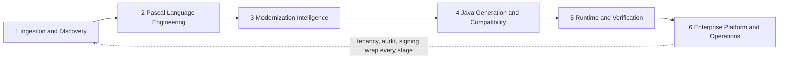

# Six-stage architecture

The platform is six stages. Each stage consumes the previous stage's evidence-backed output, may not bypass its gates, and states what it does **not** determine. Only Stage 1 is implemented. The authoritative external reference is *Final architecture v3.0* (research snapshot 12 November 2026); this page records how the repository realises it.



| # | Stage | Input → output | Does *not* determine | Status |
|---|---|---|---|---|
| 1 | Ingestion and Discovery | ZIP / Git / private Git / directory → immutable checkpoint → Application Blueprint + reports | Syntax trees, types, semantics, convertibility | **Implemented, accepted** |
| 2 | Pascal Language Engineering | Checkpoint + profiles → parsed units, project-wide symbols/types, Semantic IR | Whether a construct can be converted | Not started |
| 3 | Modernization Intelligence | Semantic IR + blueprint → capability classification, blockers, transformation plan | Generated code, behavioural equivalence | Not started |
| 4 | Java Generation and Compatibility | Plan → Java IR → Plain Java (JVM 25) / Spring Boot + compatibility library | That the output behaves like the original | Not started |
| 5 | Runtime and Verification | Original (FPC / licensed Delphi) vs Java candidate → differential evidence → scoped certificate | Anything outside the tested scope | Blocked: no Delphi licence |
| 6 | Enterprise Platform and Operations | Cross-cutting: OIDC/RBAC, audit, SBOM, signing, on-prem workers | — | Partial: ingestion hardening + tenant tokens |

## Stage 1 component view

```text
React workbench (frontend/)  ──HTTP──►  FastAPI service (tools/p1/fastapi_app.py)
                                         │  GuardMiddleware: host/origin/CSRF/tenant/headers
                                         ▼
                              JobManager (per tenant, one worker, bounded queue)
                                         ▼
 discover():  ingest ─► checkpoint ─► scan/inventory ─► dependency analysis ─► blueprint
              zip/git/    immutable,    classify,         units, libraries,     JSON schema,
              remote git/ sealed,       dialects,         DB, integrations,     reports,
              directory   verified      projects          runtime deps          diagnostics
                                         ▼
                 <store>/[tenants/<id>/]{checkpoints,discoveries,jobs,uploads}
```

Every arrow in `discover()` is static analysis: no customer script, executable, build, compiler or database call is ever made (acceptance AC-6 asserts zero process creation during a ZIP discovery that contains hostile scripts).

## Cross-stage invariants

1. No LLM/ML in the product (`tools/p1/guard.py`, ADR 0005).
2. Deterministic: identical input ⇒ byte-identical artefacts (only `run-record.json` carries wall-clock data).
3. Fail closed; nothing silently dropped; every finding evidenced.
4. A stage reads the previous stage's *sealed* output, never the raw input.
5. Detection is not support: nothing is `SUPPORTED` until Stage 3 says so with evidence.

See also: [product requirements](../product/PRODUCT_REQUIREMENTS.md), [Stage 1 design](../stage1/STAGE1_DESIGN.md), [COBOL reuse audit](../reuse/COBOL_REUSE_AUDIT.md).
